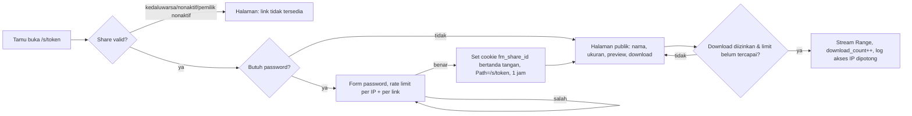
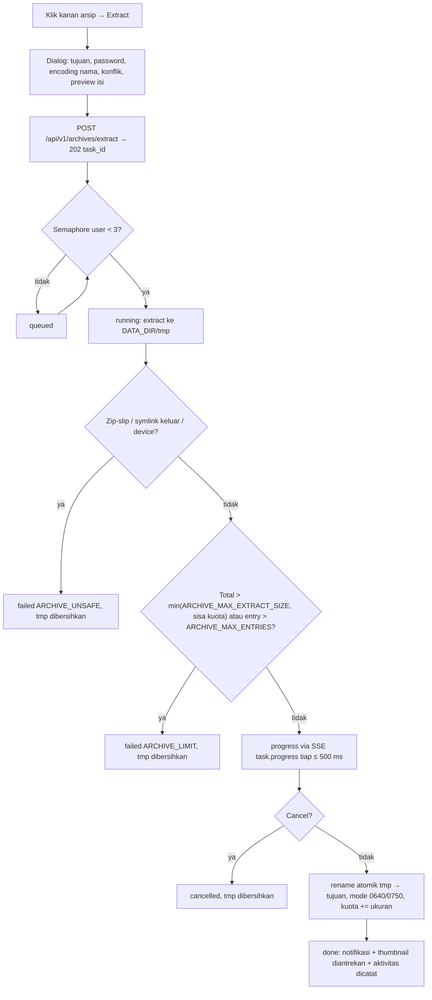

# PRD — File Manager Multi-User `file.kppbwi.app`

| | |
| --- | --- |
| Versi | 0.1 — 14 Oktober 2026 |
| Status | **Draft untuk review** (belum disetujui; belum ada kode aplikasi) |
| Pemilik produk | KPP BWI |
| Dokumen terkait | `SPEC.md` (bagaimana membangun), `PROMPT.md` (urutan step implementasi), `PROGRESS.md` (checklist step), `promp-master.md` (brief asal) |
| Konvensi | PRD menjawab *apa* dan *kenapa*. Detail teknis dirujuk ke `SPEC.md §n`. ID epic `E1`–`E15`, ID story `E3-US2`, nomor step mengikuti `PROMPT.md`. |

---

## 1. Ringkasan dan latar belakang

### 1.1 Apa yang dibangun

File manager web **self-hosted, multi-user**, berjalan di satu server Ubuntu yang dikelola aaPanel, diakses lewat `https://file.kppbwi.app`. Setiap user memiliki root folder sendiri di `/www/storage/FileManager/<username>` dan tidak bisa melihat file user lain. Fitur intinya setara file manager aaPanel (navigasi, daftar file, cari, upload/download, copy/cut/paste, Recycle Bin, compress/decompress, permission, properties, share, remote download, task), ditambah code editor ala aaPanel IDE, viewer gambar/PDF, music & video player, arsip lengkap (zip, 7z, rar, tar.*), sharing ke user terdaftar, dan admin panel.

Kode aplikasi berada di `/www/wwwroot/file.kppbwi.app` (binary tunggal Go dengan frontend React ter-embed), terpisah dari storage user di `/www/storage/FileManager`. Aplikasi berjalan di belakang Nginx aaPanel sebagai reverse proxy.

### 1.2 Kenapa tidak cukup memakai file manager aaPanel langsung

Semua alasan di bawah merujuk ke perilaku aaPanel yang tercantum di brief (`promp-master.md` bagian 4 dan 14). Klaim lain tentang aaPanel di luar itu ditandai *perlu verifikasi*.

| Masalah dengan file manager aaPanel | Dampak untuk KPP BWI | Jawaban produk ini |
| --- | --- | --- |
| File manager aaPanel adalah fitur panel server: bisa menjelajah **seluruh** server (daftar disk, path mana pun), bukan ruang kerja per orang. | Tidak mungkin memberi akses ke beberapa pegawai tanpa membuka seluruh server. | Setiap user dikunci ke root-nya sendiri; isolasi ditegakkan di filesystem (`fsjail`) dan API, bukan hanya di UI (SPEC §5). |
| Akses lewat akun panel aaPanel, yang juga mengendalikan Nginx, database, firewall, terminal, dan fitur server lain. | Membagikan akun panel = membagikan kendali server. | Aplikasi punya akun sendiri (role `admin`/`user`), tanpa akses ke panel maupun shell. |
| Tidak ada konsep share antar-user terdaftar dengan permission Viewer/Editor; share aaPanel berupa link dengan kode ekstraksi dan masa berlaku. | Kolaborasi antar pegawai harus lewat link publik atau kirim file manual. | Link publik **dan** share ke username tertentu dengan permission, menu "Dibagikan ke saya", notifikasi in-app (E10). |
| Tidak ada kuota per user, Recycle Bin per user, riwayat versi per user, audit per user. | Tidak ada akuntabilitas dan batas pemakaian per orang. | Kuota, Recycle Bin, riwayat versi, Aktivitas, dan audit log per user (E2, E11, E12). |
| UI panel server: padat tapi berorientasi admin, bercampur fitur server (terminal, rsync, tamper protection). | Membingungkan untuk user non-teknis; fitur server tidak relevan dan berbahaya. | UI modern, padat seperti aaPanel tapi hanya fitur file manager; fitur server dikecualikan (bagian 3). |
| Fitur aaPanel seperti chown, fix permission, terminal mengasumsikan user Linux dan akses root. | Bertentangan dengan isolasi multi-user. | Dikecualikan dengan alasan tertulis (bagian 3). |

### 1.3 Prinsip produk

1. **Powerful tapi tidak ramai**: semua fitur ada, muncul saat relevan (context menu, toolbar kontekstual, menu "More").
2. **Padat seperti aaPanel**: tabel dan ikon compact; tidak ada hero section, kartu besar, atau dekorasi.
3. **Keyboard-first dan mouse-friendly**: setiap aksi bisa lewat shortcut, klik kanan, dan drag & drop.
4. **Aman by default**: isolasi user di filesystem dan API; path traversal, symlink escape, zip-slip, SSRF, IDOR punya test.
5. **Cepat di folder besar**: 10.000+ item tetap mulus (virtualisasi di frontend, sort dan paging di server).
6. **Tidak ada kehilangan data tanpa konfirmasi**: delete ke Recycle Bin, simpan membuat versi, bentrok nama memunculkan dialog konflik, undo 10 detik.

### 1.4 Konteks server (fakta terverifikasi 14 Oktober 2026)

| Hal | Kondisi |
| --- | --- |
| OS | Ubuntu 24.04.5 LTS |
| Resource | **1 vCPU, 1,9 GB RAM + swap 2,8 GB**; disk sistem 19 GB (sisa ±6 GB) untuk OS, aaPanel, dan `/www/wwwroot`; **`/www/storage` adalah disk terpisah 492 GB (`/dev/vdb1`, ext4, hampir kosong)**. CPU/RAM lebih kecil dari asumsi brief (2 vCPU / 2 GB). |
| aaPanel | 8.0.7, Nginx 1.30.5. Tipe proyek **Reverse Proxy** tersedia dan terbukti bekerja (dipakai site `proxy.kppbwi.app`). |
| Toolchain | Node 24 ada; Go 1.27.2 dipasang 14 Okt 2026 dari go.dev (apt hanya 1.22). ffmpeg, libvips, poppler, ripgrep, 7zz, unrar semua belum ada (tersedia di apt; `rg` yang semula terdeteksi ternyata fungsi shell lingkungan Claude Code, bukan binary). |
| Storage | `/www/storage/FileManager` sudah ada, kosong, masih milik `www:www`; user Linux `filemanager` belum ada. |

Implikasi dibahas di bagian 8 (NFR), 10 (risiko), dan 11 (asumsi, pertanyaan).

---

## 2. Tujuan dan metrik sukses

| # | Tujuan | Metrik | Target | Cara mengukur |
| --- | --- | --- | --- | --- |
| G1 | Paritas aaPanel | Baris "Wajib" di matriks paritas (bagian 5) yang terpenuhi | 100 % sebelum v1.0 | Checklist acceptance criteria per epic; review independen R-A…R-F |
| G2 | Isolasi multi-user terbukti | Temuan kritis/tinggi pada test IDOR, path traversal, symlink, zip-slip, SSRF | **0** | Test otomatis (SPEC §10.6, §11) + review R-F |
| G3 | Cepat di folder besar | Listing folder 10.000 item: API p95; render pertama | p95 < 500 ms; < 1 detik | Performance test Step 21 (SPEC §11) |
| G4 | Navigasi responsif | Pindah folder dengan cache hangat | < 150 ms | Playwright timing |
| G5 | Upload besar andal | File 20 GB berhasil, bisa resume setelah koneksi putus; RAM backend stabil | Lulus; RAM tidak tumbuh sebanding ukuran file | Test upload 1 GB + resume (Step 12a); profil memori |
| G6 | Ringan | Idle RAM backend; bundle JS awal | < 100 MB; < 300 KB gzip | `systemctl status` + `pnpm build` report |
| G7 | Bisa dipakai tanpa bantuan | Tugas inti (login pertama, upload, buat folder, share ke user, buka file yang dibagikan) selesai tanpa bantuan | ≥ 90 % dari 5 user uji coba | Sesi UAT setelah M4 |
| G8 | Tidak kehilangan data | Insiden kehilangan file tanpa konfirmasi | 0 | Laporan user + audit log |
| G9 | Aksesibilitas | Pelanggaran axe serius/kritis pada layar utama | 0 | Audit axe Step 21 |
| G10 | Deploy ulang andal | Deploy dari server kosong mengikuti `docs/DEPLOY-AAPANEL.md` | Berhasil dalam 1 sesi tanpa langkah tak terdokumentasi | Smoke test Step 22 |
| G11 | Coverage | Coverage backend inti (`fsjail`, auth, share, arsip) | ≥ 80 % (`fsjail` ≥ 90 %) | `make test` di CI |

---

## 3. Non-goals

Fitur di bawah **sengaja** tidak dibawa dari aaPanel atau ditunda. Tabel ini mengikat; jika ada yang ingin dibuka, harus lewat revisi PRD.

| Fitur | Keputusan | Alasan |
| --- | --- | --- |
| Terminal web | Dikecualikan | Shell membuka akses ke seluruh server dan menembus isolasi antar-user. Jika kelak dibutuhkan, harus lewat container/namespace terisolasi sebagai proyek terpisah. |
| chown / owner Linux | Dikecualikan | User aplikasi bukan user Linux; semua file milik `filemanager`. Mengganti owner tidak bermakna dan butuh root. |
| Backup/restore permission, fix permission | Dikecualikan | Relevan untuk web root situs, bukan storage pribadi. |
| Tamper protection, rsync, cloud storage, malware scan, composer/git, konversi format | Dikecualikan | Fitur panel server aaPanel, bukan fitur file manager. |
| Menjelajah path di luar `/www/storage/FileManager` | Dikecualikan | aaPanel bisa menjelajah seluruh server; aplikasi ini sengaja dikunci ke root masing-masing user. |
| Daftar disk / mount point | Dikecualikan | Tidak bermakna di dalam root user; diganti indikator kuota (E2). |
| Transcoding video, preview Office, email/SMTP | Ditunda (M6, opsional) | Biaya CPU dan kompleksitas tinggi (server 1 vCPU); tidak memblokir nilai inti. |
| Preview HTML live | Ditunda (M6) | Butuh origin konten terpisah (`CONTENT_BASE_URL`); v1 memakai origin yang sama dan hanya menampilkan source HTML (SPEC §13 ADR-06). |
| WebDAV / sinkronisasi klien desktop | Ditunda | Kandidat fitur berikutnya setelah v1 stabil. |
| Registrasi publik, SSO/LDAP | Ditunda | Di v1 hanya admin yang membuat user. |
| Multi-server, object storage (S3) | Ditunda | v1 single-server dengan filesystem lokal. |
| Membuat arsip `.rar` | Nonaktif secara default | Butuh binary `rar` berlisensi; diaktifkan hanya jika `RAR_PATH` diisi admin. |

---

## 4. Persona dan skenario utama

| Persona | Siapa | Kebutuhan utama | Yang tidak boleh terjadi |
| --- | --- | --- | --- |
| **Admin** | Pengelola aplikasi di KPP BWI; juga memakai file manager untuk filenya sendiri. | Membuat/mengelola user, kuota, setting sistem, audit log, maintenance. | Secara default **tidak** bisa melihat isi folder user lain (`ADMIN_CAN_BROWSE_USERS=false`); jika diaktifkan, setiap akses tercatat. |
| **User** | Pegawai dengan akun yang dibuat admin. | Mengelola file miliknya, mengedit kode/konfigurasi, membuka media, membagikan file. | Melihat file user lain; keluar dari root-nya; kehilangan file tanpa konfirmasi. |
| **Penerima share** (user terdaftar) | User lain yang diberi akses ke item tertentu. | Membuka item lewat "Dibagikan ke saya"; mengedit jika permission Editor. | Melihat path di atas item, kuota, atau item lain milik pemilik; reshare tanpa izin. |
| **Tamu** (tanpa akun) | Pihak luar yang menerima link publik. | Preview dan download; upload jika "file request" diaktifkan. | Melihat apa pun di luar item yang dibagikan; menebak link lain. |

### 4.1 Skenario naratif

- **Admin — hari pertama.** Admin membuka `https://file.kppbwi.app`, login dengan `ADMIN_USERNAME` dan password awal dari `.env`, langsung diarahkan ke halaman ganti password (API lain menolak `403 PASSWORD_CHANGE_REQUIRED`). Setelah ganti, admin membuat user `budi` dengan password sementara dan kuota 10 GB, lalu menyalin password itu sekali untuk diberikan ke Budi.
- **User — upload & kerja harian.** Budi login pertama kali, diwajibkan ganti password; folder `/www/storage/FileManager/budi` dibuat saat itu. Ia drag 300 foto dan satu arsip 2 GB ke browser; upload berjalan ber-chunk, bisa di-pause, dan lanjut otomatis setelah Wi-Fi putus. Ia klik kanan arsip → Extract (task background dengan progress), membuka folder hasil dalam Large icons, membuat tag warna, dan mengedit `config.yaml` di editor dengan riwayat versi.
- **Penerima share.** Budi membagikan folder `laporan/` ke `sari` dengan permission Editor. Sari melihat notifikasi, membuka "Dibagikan ke saya", mengunggah revisi ke folder itu (dihitung ke kuota Budi), dan mengedit file di editor. Sari tidak melihat folder lain milik Budi.
- **Tamu.** Budi membuat link publik ber-password untuk `brosur.pdf` yang berlaku 7 hari dengan batas 50 download. Tamu membuka `/s/<token>`, memasukkan password, melihat preview PDF, dan mengunduh. Halaman publik memakai `noindex`, tidak menampilkan path, dan setiap akses tercatat ringkas untuk Budi.

---

## 5. Matriks paritas aaPanel

Sumber baris: `promp-master.md` bagian 4 (disusun pemilik dari source code aaPanel `class/files.py`, bundle `view-files.js`, `feature-FileEditor.js`, dicek 14 Oktober 2026). Perilaku UI bisa berbeda antar versi. **Status**: Wajib = batas minimal yang harus setara; Diperluas = wajib + fitur tambahan; Dikecualikan = non-goal (bagian 3). **Step** merujuk ke `PROMPT.md`.

| Fitur aaPanel | Status | Epic | Step PROMPT |
| --- | --- | --- | --- |
| Navigasi: breadcrumb + address bar yang bisa diketik, riwayat direktori, up/refresh, tab folder (close others, close right, batas jumlah) | Diperluas (tab maks. 10; daftar disk → indikator kuota) | E3, E2 | 7a, 7b, 10a |
| Daftar file: kolom nama/permission/ukuran/mtime/remark/aksi; sort; paging; list view & icon view | Diperluas (5 mode view, kolom pilihan, sort server-side) | E3 | 5, 7a, 7b, 8 |
| Cari nama di folder aktif atau subfolder (aaPanel batas 3.000) | Diperluas (filter tipe, ukuran, tanggal; batas 5.000) | E9 | 15 |
| Cari isi file: keyword/regex, case, whole word, subfolder, filter ekstensi/ukuran/mtime; hasil per baris → editor | Wajib | E9, E7 | 15, 16b |
| Replace di banyak file + log replace | Diperluas (preview diff, rollback via versi) | E9, E11 | 15 |
| Buat: file baru, folder baru, soft link, salinan | Wajib (symlink hanya di dalam root user) | E4 | 5, 9a, 9b |
| Upload: drag & drop, chunk + resume, dialog konflik, kecepatan & total waktu | Wajib (protokol tus) | E5 | 12a |
| Remote download: URL → folder + nama file, sebagai task | Wajib (+ SSRF guard) | E5, E15 | 13 |
| Download: file tunggal; compress lalu download | Diperluas (zip streaming tanpa file sementara) | E5 | 12b |
| Copy/Cut/Paste batch, Ctrl+C/X/V, dialog konflik paste, rename, delete satu/banyak | Wajib | E4 | 9a, 9b |
| Recycle Bin: aktif/nonaktif, filter tipe, cari, restore ke asal/folder lain, hapus permanen, kosongkan, batch | Diperluas (per user, auto-purge) | E11 | 10a |
| Compress: tar.gz, zip, rar | Diperluas (7z, tar.bz2/xz/zst, password, level) | E6 | 14a |
| Decompress: zip, rar, gz, tgz, bz2, war; password, encoding nama, folder tujuan, warning overwrite | Diperluas (7z, tar.xz, tar.zst, iso read-only) | E6 | 14a, 14b |
| Preview arsip: lihat isi, extract sebagian, tambah file, hapus entry | Wajib (tambah/hapus minimal untuk zip) | E6 | 14b |
| Permission: chmod rwx, apply ke subfolder; chown; backup/restore permission; fix permission | Wajib untuk chmod + rekursif; chown/backup/fix **Dikecualikan** | E4 | 9a, 9b |
| Properties: nama, tipe, lokasi, ukuran, user/group, uid/gid, permission, atime/mtime/ctime, inode, MD5/SHA-1 (≤ 100 MB), riwayat versi + restore | Diperluas (tanpa uid/gid/inode; SHA-256; checksum sebagai task; verifikasi hash) | E4, E11 | 10a, 10b, 16b |
| Ukuran folder: hitung ukuran, jumlah file/folder, analisis disk | Diperluas (treemap + 50 terbesar per user) | E4, E2 | 10a, 10b |
| Organisasi: favorit, pin to top, remark per file, copy path, buka di jendela baru, buka lokasi file | Diperluas (+ tag warna) | E4 | 10b, 7b |
| Share: link dengan kode ekstraksi, masa berlaku, catatan; daftar share; batalkan | Diperluas (share ke user, QR, log akses, limit download, file request) | E10 | 18a, 18b |
| Media: preview gambar + thumbnail, video player dengan playlist folder; pdf.js | Diperluas (image viewer penuh, PDF viewer, music player, mini-player) | E8, E3 | 8, 17a, 17b |
| Editor online multi-tab (toolbar, tab, explorer, footer, dialog encoding/EOL/tab size/theme/riwayat) | Diperluas (konflik ETag, diff versi, Monarch nginx/apache, draft lokal) | E7, E11 | 16a, 16b |
| Task: antrian, progress, estimasi sisa waktu, log, cancel | Wajib (progress via SSE) | E15 | 11 |
| Riwayat operasi: log operasi file, cari, hapus | Diperluas ("Aktivitas" per user + audit log admin) | E15, E12 | 10b, 19b |
| Terminal di folder aktif | Dikecualikan | — | — |
| Tamper protection, file sync (rsync), cloud storage, malware scan, composer/git, konversi format | Dikecualikan | — | — |
| Daftar disk | Dikecualikan (diganti kuota) | E2 | 10a |

Verifikasi silang: setiap baris Wajib/Diperluas memiliki epic dan minimal satu step; checklist rilis (`promp-master.md` bagian 18) mengulang pemeriksaan ini di R-F.

---

## 6. Epic dan user story

Prioritas MoSCoW: **M** Must (wajib v1.0), **S** Should (v1.0 jika waktu cukup, paling lambat v1.1), **C** Could (M6/opsional), **W** Won't (v1). Acceptance criteria (AC) berformat Given/When/Then; AC teknis lengkap ada di `SPEC.md §8`.

### E1 — Auth & Akun

**Tujuan:** hanya akun yang dibuat admin yang bisa masuk; admin pertama berasal dari `.env` sekali pakai; sesi bisa dicabut; brute force dibatasi. (SPEC §8.1, §10.4, §10.5)

| ID | Story | Prio | Acceptance criteria |
| --- | --- | --- | --- |
| E1-US1 | Sebagai sistem, saat start pertama dan tabel user kosong, saya membuat admin dari `ADMIN_USERNAME`/`ADMIN_INITIAL_PASSWORD` agar instalasi bisa dipakai tanpa langkah manual. | M | **Given** DB baru dan env terisi **When** aplikasi start **Then** user `admin` role `admin` dibuat dengan `must_change_password=true`; start berikutnya tidak mengubah password; jika env masih berisi password awal setelah diganti, log memuat warning. |
| E1-US2 | Sebagai admin yang login pertama, saya dipaksa mengganti password sebelum memakai fitur lain. | M | **Given** `must_change_password=true` **When** login sukses **Then** UI mengarahkan ke `/change-password`; **When** memanggil API lain **Then** `403 PASSWORD_CHANGE_REQUIRED`; **When** password baru = password awal atau < 12 karakter atau ada di daftar password umum **Then** ditolak `VALIDATION_FAILED`. |
| E1-US3 | Sebagai user, saya login dengan username + password dan sesi saya bertahan di cookie yang aman. | M | **Given** kredensial benar **When** login **Then** cookie `fm_session` `HttpOnly; Secure; SameSite=Lax`, baris `sessions` dibuat, idle timeout 2 jam, absolut 168 jam; **When** logout **Then** sesi dicabut di DB dan cookie dihapus. |
| E1-US4 | Sebagai sistem, saya membatasi percobaan login agar password tidak bisa ditebak. | M | **Given** 5 login gagal untuk satu username dalam 15 menit **When** percobaan ke-6 **Then** `423 ACCOUNT_LOCKED` dengan durasi bertahap 1/5/15/60 menit; rate limit IP 20/menit mengembalikan `429 RATE_LIMITED`; semua gagal/lock tercatat di audit log. |
| E1-US5 | Sebagai user, setiap request yang mengubah state saya butuh CSRF token agar situs lain tidak bisa memicu aksi atas nama saya. | M | **Given** sesi valid **When** POST tanpa header `X-CSRF-Token` yang cocok **Then** `403 CSRF_INVALID`; **When** `Sec-Fetch-Site: cross-site` **Then** ditolak. |
| E1-US6 | Sebagai user, saya bisa mengaktifkan TOTP 2FA. | C | **Given** 2FA aktif **When** login **Then** diminta kode 6 digit; kode pemulihan tersedia; admin bisa mereset 2FA. (M6) |
| E1-US7 | Sebagai user nonaktif, saya tidak bisa login dan link publik saya berhenti bekerja. | M | **Given** status `disabled` **When** login **Then** `403 ACCOUNT_DISABLED`; sesi aktif dicabut; `/s/<token>` miliknya mengembalikan `SHARE_DISABLED`. |

### E2 — Provisioning folder & Kuota

**Tujuan:** folder user dibuat idempoten saat login pertama; pemakaian dibatasi kuota yang ditegakkan di server. (SPEC §8.2)

| ID | Story | Prio | Acceptance criteria |
| --- | --- | --- | --- |
| E2-US1 | Sebagai user baru, folder saya dibuat otomatis saat login pertama sukses, bukan saat akun dibuat. | M | **Given** `home_provisioned_at` kosong **When** login sukses **Then** `MkdirAll` `/www/storage/FileManager/<username>` mode `0750`, `home_provisioned_at` diisi; **When** folder sudah ada **Then** tidak ditimpa dan admin mendapat peringatan (notifikasi + audit). |
| E2-US2 | Sebagai sistem, saya menolak username yang tidak sesuai aturan agar tidak bentrok dengan `.system` atau route. | M | **Given** username tidak cocok `^[a-z0-9][a-z0-9_-]{2,31}$` atau ada di daftar terlarang (SPEC §5.2) **When** admin membuat user **Then** `VALIDATION_FAILED`; username tidak bisa diubah setelah dibuat. |
| E2-US3 | Sebagai user, saya melihat kuota terpakai di sidebar dan status bar. | M | **Given** kuota 10 GB terpakai 6,2 GB (termasuk Recycle Bin dan versi, ditampilkan terpisah) **When** membuka file manager **Then** indikator "6,2 GB dari 10 GB" (62 %) tampil; berubah merah ≥ 90 %. |
| E2-US4 | Sebagai sistem, saya menolak operasi yang akan melampaui kuota sebelum data ditulis. | M | **Given** sisa kuota 100 MB **When** upload/copy/extract/remote download membutuhkan > 100 MB **Then** `413 QUOTA_EXCEEDED` pada precheck atau task gagal dengan pesan jelas dan hasil parsial dibersihkan. |
| E2-US5 | Sebagai admin, saya bisa mengubah kuota per user dan menjalankan rekalkulasi. | M | **Given** kuota diubah **When** disimpan **Then** berlaku pada operasi berikutnya; rekalkulasi walk berjalan terjadwal 03:00 dan on-demand dari Maintenance. |

### E3 — Browsing & Views

**Tujuan:** navigasi dan daftar file sepadat aaPanel, dengan 5 mode view, kolom pilihan, sort server-side, dan performa 10.000+ item. (SPEC §8.3, §8.4, §9)

| ID | Story | Prio | Acceptance criteria |
| --- | --- | --- | --- |
| E3-US1 | Sebagai user, saya bernavigasi lewat breadcrumb, address bar yang bisa diketik, back/forward/up/refresh, dan riwayat folder. | M | **Given** di `/Proyek/website` **When** mengetik `/Proyek/assets` + Enter **Then** folder berpindah; `Alt+←` kembali; `Backspace`/`Alt+↑` ke induk; breadcrumb punya dropdown folder sibling dan collapse saat overflow. |
| E3-US2 | Sebagai user, saya membuka beberapa folder dalam tab (maks. 10) dengan close others/close right. | M | **Given** 10 tab terbuka **When** membuka tab ke-11 **Then** ditolak dengan pesan; tab dipulihkan setelah reload (disimpan per user). |
| E3-US3 | Sebagai user, saya memilih view Details, List, Tiles, Large icons, Extra large icons (Ctrl+1…5). | M | **Given** folder berisi gambar **When** memilih Large icons **Then** thumbnail 96–128 px tampil lazy-load dengan placeholder ikon; pilihan view disimpan per user, opsi "ingat view per folder". |
| E3-US4 | Sebagai user, saya memilih kolom yang tampil (Nama selalu; Ukuran, Tipe, Diubah, Catatan default) dan mengubah lebar/urutannya. | M | **Given** menu "Kolom" **When** mengaktifkan Dimensi dan Durasi **Then** kolom muncul dengan nilai dari cache metadata ("—" jika belum ada); lebar/urutan/visibilitas disimpan per user. |
| E3-US5 | Sebagai user, saya mengurutkan per kolom (asc → desc → default), sort sekunder Shift+klik, dengan natural sort dan "Folder di atas". | M | **Given** file `file2`, `file10`, `File1` **When** sort nama asc **Then** urutan `File1, file2, file10`; item pin selalu paling atas; sort dilakukan di server dan konsisten antar halaman. |
| E3-US6 | Sebagai user, folder 10.000 item tampil cepat tanpa browser lambat. | M | **Given** folder 10.000 file **When** dibuka **Then** API p95 < 500 ms, render pertama < 1 detik, scroll tervirtualisasi, infinite scroll memuat halaman berikut (cursor). |
| E3-US7 | Sebagai user, saya menyeleksi dengan klik, Ctrl/Shift+klik, Ctrl+A, invert, marquee (grid), checkbox (Details). | M | **Given** 50 item **When** klik item 3 lalu Shift+klik item 10 **Then** 8 item terpilih; status bar menampilkan "8 dipilih (12,4 MB)". |
| E3-US8 | Sebagai user, saya menyaring cepat dan type-ahead di folder aktif. | S | **Given** mengetik `inv` di Filter **Then** daftar menyusut tanpa request server; mengetik huruf saat fokus di daftar melompat ke item pertama yang cocok. |
| E3-US9 | Sebagai user, saya membuka panel Preview/Details di kanan dan Quick Look dengan Space. | S | **Given** satu gambar terpilih **When** Space **Then** modal preview tampil; `Alt+P` toggle panel kanan dengan metadata dan aksi cepat. |
| E3-US10 | Sebagai user, setiap view punya empty state, loading skeleton, dan error state. | M | **Given** folder kosong **Then** empty state dengan tombol "Upload"/"Folder baru"; **Given** API gagal **Then** error state dengan tombol coba lagi. |

### E4 — Operasi file

**Tujuan:** semua operasi dasar aman, bisa dibatalkan, dan tersedia lewat toolbar, klik kanan, keyboard, dan drag & drop. (SPEC §8.5, §8.7, §9.5)

| ID | Story | Prio | Acceptance criteria |
| --- | --- | --- | --- |
| E4-US1 | Sebagai user, saya membuat file kosong, file dari template, folder, dan symlink. | M | **Given** area kosong → Baru **When** memilih template `yaml` **Then** `baru.yaml` dibuat dengan isi template dan rename inline aktif; symlink yang menunjuk keluar root ditolak `SYMLINK_ESCAPE`. |
| E4-US2 | Sebagai user, saya copy/cut/paste lintas folder dan tab, serta "Pindah ke…/Salin ke…" dengan folder picker. | M | **Given** 3 file di clipboard **When** paste di folder lain **Then** operasi kecil sinkron, besar menjadi task; move di filesystem sama memakai `rename` atomik. |
| E4-US3 | Sebagai user, bentrok nama memunculkan dialog Timpa / Lewati / Ganti nama otomatis dengan perbandingan ukuran & tanggal dan "Terapkan ke semua". | M | **Given** `a.txt` sudah ada di tujuan **When** paste **Then** dialog konflik; "Ganti nama" menghasilkan `a (1).txt`. |
| E4-US4 | Sebagai user, saya tidak bisa memindahkan folder ke dalam dirinya sendiri atau memakai nama tidak valid. | M | **Given** folder `A` **When** move ke `A/B` **Then** `VALIDATION_FAILED`; nama berisi `/`, null byte, karakter kontrol ditolak `NAME_INVALID`; nama `CON`, trailing dot/spasi memberi warning tapi diizinkan. |
| E4-US5 | Sebagai user, saya rename inline (F2) dan batch rename (find/replace, regex, `{n}`, huruf besar/kecil) dengan preview. | M | **Given** 20 foto **When** batch rename pola `foto_{n}` **Then** preview menampilkan hasil dan konflik sebelum eksekusi; hasil akhir sesuai preview. |
| E4-US6 | Sebagai user, delete memindahkan ke Recycle Bin; Shift+Delete hapus permanen dengan konfirmasi. | M | **Given** 60 item terpilih **When** Shift+Delete **Then** harus mengetik `HAPUS`; **Given** Delete biasa **Then** item masuk Recycle Bin dan toast "Urungkan" 10 detik. |
| E4-US7 | Sebagai user, saya mengurungkan rename, move, dan delete terakhir lewat toast. | M | **Given** baru rename `a`→`b` **When** klik Urungkan dalam 10 detik **Then** nama kembali `a`; referensi favorit/share ikut kembali. |
| E4-US8 | Sebagai user, saya drag & drop item ke folder, breadcrumb, atau sidebar (move; Ctrl = copy), dan drag dari OS = upload. | M | **Given** drag `x.pdf` ke folder `Arsip` di daftar **Then** move; ke `Favorit` di sidebar **Then** jadi favorit; drag dari desktop **Then** upload ke folder aktif. |
| E4-US9 | Sebagai user, saya mengubah permission (mode bits) satu atau banyak item, opsional rekursif. | M | **Given** folder **When** set `755` rekursif **Then** semua anak berubah; chown tidak tersedia (non-goal). |
| E4-US10 | Sebagai user, saya menandai favorit, pin, catatan, tag warna, copy path, buka lokasi file, dan melihat Properties (Alt+Enter). | M | **Given** file di hasil Search **When** "Buka lokasi file" **Then** folder induk terbuka dengan item ter-highlight; Properties menampilkan nama, tipe, lokasi, ukuran, permission, atime/mtime/ctime, catatan, tag, status share, riwayat versi. |
| E4-US11 | Sebagai user, saya menghitung ukuran folder dan checksum (MD5/SHA-1/SHA-256) on-demand serta memverifikasi hash. | S | **Given** file 500 MB **When** "Checksum" **Then** task dengan progress; tempel hash → "Cocok/Tidak cocok". |
| E4-US12 | Sebagai user, saya melihat Analisis penyimpanan (treemap + 50 file terbesar). | S | **Given** halaman `/storage` **Then** treemap per folder tingkat atas dan daftar 50 terbesar dengan aksi buka lokasi/hapus. |
| E4-US13 | Sebagai user, saya menjalankan Command palette (Ctrl+K) untuk lompat folder, aksi, dan cari file. | S | **Given** Ctrl+K **When** mengetik "trash" **Then** aksi "Buka Recycle Bin" muncul; Enter menjalankan. |
| E4-US14 | Sebagai user, saya memakai dual-pane dan duplicate finder. | C | Dua panel berdampingan dengan drag antar folder; pencarian duplikat ukuran → hash sebagai task. (M6) |

### E5 — Upload, Download & Remote download

**Tujuan:** upload resumable yang tahan koneksi putus; download streaming dengan Range; remote download aman dari SSRF. (SPEC §8.8, §8.9, §8.10)

| ID | Story | Prio | Acceptance criteria |
| --- | --- | --- | --- |
| E5-US1 | Sebagai user, upload saya ber-chunk, bisa pause/resume/cancel, lanjut otomatis setelah koneksi putus atau reload. | M | **Given** upload 1 GB sampai 40 % **When** koneksi putus 1 menit lalu pulih **Then** upload lanjut dari ±40 % tanpa mengulang; **When** reload halaman **Then** daftar upload belum selesai bisa dilanjutkan. |
| E5-US2 | Sebagai user, sebelum upload saya mendapat precheck kuota, ukuran maksimum, ekstensi diblokir, dan konflik nama. | M | **Given** file `.exe` diblokir admin **When** menambahkan ke antrian **Then** ditolak dengan alasan; **Given** nama sudah ada **Then** dialog Timpa/Lewati/Rename + "terapkan ke semua". |
| E5-US3 | Sebagai user, panel transfer menampilkan progress per file, kecepatan, sisa waktu, dan tetap tampil saat pindah folder. | M | **Given** 3 file paralel **Then** panel pojok kanan bawah bisa diciutkan; selesai → notifikasi dan thumbnail diantrekan. |
| E5-US4 | Sebagai user, saya upload folder dengan struktur utuh dan paste gambar dari clipboard. | S | **Given** drag folder `foto/2025/` **Then** struktur dibuat; Ctrl+V gambar clipboard → `clipboard-<timestamp>.png`. |
| E5-US5 | Sebagai user, download file tunggal mendukung resume dan nama Unicode. | M | **Given** `GET /download` dengan `Range: bytes=1000-` **Then** `206` dengan `ETag`, `Last-Modified`, `Content-Disposition` `filename*`; file 20 GB tidak menaikkan RAM backend. |
| E5-US6 | Sebagai user, banyak item atau folder diunduh sebagai zip streaming tanpa file sementara. | M | **Given** folder 5 GB **When** "Download sebagai zip" **Then** stream mulai < 2 detik, tidak ada file di `tmp`, maks. 3 download paralel per user. |
| E5-US7 | Sebagai user, ``, `<video>`, dan download manager memakai signed URL berumur pendek. | M | **Given** URL dengan `exp` lewat **Then** `403 SIGNATURE_EXPIRED`; player meminta URL baru dan melanjutkan dari posisi; TTL download 5 menit, media 2 jam. |
| E5-US8 | Sebagai user, saya mengunduh dari URL http/https ke folder tujuan sebagai task dengan progress, cancel, retry, dan resume Range. | M | **Given** 3 URL (satu per baris) **Then** 3 task; nama default dari `Content-Disposition`/URL; batas ukuran min(`REMOTE_DOWNLOAD_MAX_SIZE`, sisa kuota). |
| E5-US9 | Sebagai sistem, remote download menolak alamat internal (SSRF) termasuk lewat redirect dan DNS rebinding. | M | **Given** URL ke `127.0.0.1`, `10.0.0.5`, `169.254.169.254`, `[::1]`, hostname yang resolve ke IP private, atau redirect ke sana **Then** `SSRF_BLOCKED`; IP di-pin saat connect; maks. 5 redirect; admin bisa menonaktifkan fitur atau mengatur allowlist/denylist domain. |

### E6 — Arsip

**Tujuan:** compress/extract semua format matriks sebagai task, dengan proteksi zip-slip dan zip bomb. (SPEC §8.11)

| ID | Story | Prio | Acceptance criteria |
| --- | --- | --- | --- |
| E6-US1 | Sebagai user, saya compress ke zip, 7z, tar, tar.gz, tar.bz2, tar.xz, tar.zst (dan rar jika `rar` terpasang) dengan nama output, lokasi, level, password (zip AES-256 / 7z), opsi hapus asli. | M | **Given** 2 folder terpilih **When** compress 7z password **Then** task dengan progress; hasil terbuka di 7-Zip dengan password; rar tidak muncul jika `RAR_PATH` kosong. |
| E6-US2 | Sebagai user, saya extract zip, 7z, rar v4/v5, tar.*, gz/bz2/xz/zst tunggal, war/jar, iso (read-only) dengan password, encoding nama file, tujuan, dan penanganan konflik. | M | **Given** zip lama dengan nama GBK **When** extract encoding `auto` **Then** nama benar; **Given** rar ber-password **When** password salah **Then** `ARCHIVE_PASSWORD_WRONG`. |
| E6-US3 | Sebagai sistem, saya menolak entry berbahaya (zip-slip, symlink keluar, path absolut) dan melewati device/FIFO. | M | **Given** fixture `evil-slip.zip` berisi `../../etc/x` **When** extract **Then** `ARCHIVE_UNSAFE`, tidak ada file di luar tujuan; symlink dalam arsip yang mengarah keluar ditolak. |
| E6-US4 | Sebagai sistem, saya menghentikan extract yang melampaui batas (zip bomb). | M | **Given** fixture bomb kecil rasio ekstrem **When** extract **Then** berhenti `ARCHIVE_LIMIT`, hasil parsial di `tmp` dibersihkan; batas total = min(`ARCHIVE_MAX_EXTRACT_SIZE`, sisa kuota), entry ≤ `ARCHIVE_MAX_ENTRIES`; arsip bersarang tidak diekstrak otomatis. |
| E6-US5 | Sebagai user, saya membuka arsip seperti folder (tree read-only, ukuran asli/terkompresi), preview teks/gambar di dalamnya, extract item terpilih, tambah/hapus entry (zip). | M | **Given** `data.zip` **When** "Lihat isi arsip" **Then** tree tampil tanpa extract penuh; hapus satu entry → zip ditulis ulang atomik; format lain menampilkan alasan tidak didukung. |
| E6-US6 | Sebagai sistem, extract dilakukan ke `tmp` lalu dipindah atomik; mode file 0640/folder 0750; setuid/setgid diabaikan; CLI dipanggil tanpa shell dengan timeout dan `nice`. | M | **Given** extract selesai **Then** tidak ada file dengan bit setuid; proses `7zz` berjalan `nice 10`, argumen array dengan `--`. |

### E7 — Editor

**Tujuan:** code editor setara aaPanel IDE dengan multi-tab, explorer, encoding/EOL eksplisit, konflik aman, dan riwayat versi. (SPEC §8.13)

| ID | Story | Prio | Acceptance criteria |
| --- | --- | --- | --- |
| E7-US1 | Sebagai user, saya membuka editor sebagai workspace `/editor` atau modal yang bisa di-maximize, dengan multi-tab (maks. 20), indikator belum disimpan, close others/right/all, dan tab dipulihkan setelah reload. | M | **Given** 3 tab, 1 belum disimpan **When** close all **Then** dialog Simpan/Jangan simpan/Batal; **When** reload **Then** tab terbuka kembali. |
| E7-US2 | Sebagai user, saya menyimpan dengan Ctrl+S / Save all Ctrl+Shift+S / tutup tab Alt+W; draft lokal pulih setelah browser crash. | M | **Given** mengetik lalu tab browser ditutup paksa **When** membuka file yang sama **Then** tawaran "pulihkan draft". |
| E7-US3 | Sebagai user, jika file berubah di server sejak dibuka, simpan tidak menimpa diam-diam. | M | **Given** file diubah oleh upload **When** Ctrl+S dengan ETag lama **Then** `409 CONFLICT` dan dialog lihat diff / timpa / muat ulang. |
| E7-US4 | Sebagai user, setiap simpan membuat versi (maks. `FILE_VERSION_LIMIT`, dilewati jika sama) yang bisa dilihat read-only, di-diff side-by-side, dan di-restore. | M | **Given** 7 versi **When** restore versi 3 **Then** isi sekarang disimpan sebagai versi baru dulu, lalu file = versi 3; footer menampilkan "Riwayat (8)". |
| E7-US5 | Sebagai user, encoding terdeteksi otomatis (UTF-8/BOM, UTF-16, GBK, Big5, Shift_JIS, ISO-8859-1, Windows-1252) dan saya bisa "Reopen with encoding" / "Save with encoding". | M | **Given** file GBK **When** dibuka **Then** teks benar dan footer "GBK"; simpan mempertahankan GBK kecuali diubah. |
| E7-US6 | Sebagai user, line ending LF/CRLF ditampilkan, bisa diubah, dan aslinya dipertahankan (tidak dikonversi otomatis). | M | **Given** file CRLF **When** simpan tanpa mengubah EOL **Then** tetap CRLF. |
| E7-US7 | Sebagai user, bahasa terdeteksi dari ekstensi/shebang/nama file dan mencakup semua mode editor aaPanel; Nginx/Apache memakai grammar Monarch. | M | **Given** `nginx.conf` **Then** highlight nginx; dropdown bahasa bisa diganti manual. |
| E7-US8 | Sebagai user, saya punya find/replace regex, Find in files (klik hasil membuka baris), Go to line, command palette F1, multi-cursor, folding, format document, Markdown preview, pengaturan per user (theme, font, tab size, wrap, minimap). | M | **Given** Find in files `TODO` **Then** hasil per baris; klik membuka file di baris itu. |
| E7-US9 | Sebagai user, file di atas `EDITOR_MAX_FILE_SIZE` dibuka read-only mode tail dengan "muat lebih banyak"; file biner ditolak dengan tawaran download. | M | **Given** log 50 MB **Then** 1.000 baris terakhir tampil read-only; **Given** `.png` **Then** `BINARY_FILE` + tombol download. |
| E7-US10 | Sebagai penerima share Editor, saya mengedit file di folder yang dibagikan dengan editor yang sama. | M | **Given** share permission Editor **When** membuka file **Then** editor bisa simpan; versi tercatat atas nama pemilik dengan `created_by` penerima. |

### E8 — Viewer & Player

**Tujuan:** membuka gambar, PDF, audio, video, teks/Markdown/CSV/JSON di overlay dengan prev/next, deep link, dan konten disajikan aman. (SPEC §8.14, §13 ADR-06)

| ID | Story | Prio | Acceptance criteria |
| --- | --- | --- | --- |
| E8-US1 | Sebagai user, image viewer mendukung jpg/png/gif/webp/avif/bmp/ico/svg (+ tiff/heic via konversi server jika libvips mendukung), zoom/pan/rotate/flip/fullscreen/slideshow/filmstrip, panel EXIF (GPS disembunyikan default), versi resized 2048 px dan original saat 100 %. | M | **Given** folder 200 foto **When** buka satu **Then** `←/→` berpindah, gambar berikutnya di-preload; SVG ditampilkan sebagai ``/raster, tidak pernah di-inline ke DOM. |
| E8-US2 | Sebagai user, PDF viewer (pdf.js) menyediakan thumbnail halaman, outline, zoom, cari teks, lompat halaman, rotasi, print, download, streaming Range, dan input password. | M | **Given** PDF 200 MB **Then** halaman pertama tampil sebelum unduhan selesai; PDF ber-password meminta password. |
| E8-US3 | Sebagai user, music player memutar mp3/m4a/ogg/opus/wav/flac dengan playlist folder, shuffle/repeat, kecepatan, metadata & cover, Media Session API, dan mini-player persisten. | M | **Given** memutar lagu **When** pindah folder **Then** musik tetap berjalan di mini-player bawah. |
| E8-US4 | Sebagai user, video player streaming Range, kecepatan 0,25–2×, fullscreen, PiP, subtitle `.vtt`/`.srt` sidecar, lanjut dari posisi terakhir, playlist folder, shortcut Space/←/→/J/K/L/F/M; format yang tidak didukung browser memberi pesan jelas + download. | M | **Given** `film.mkv` HEVC **When** `canPlayType` + `ffprobe` menyatakan tidak didukung **Then** kartu "tidak bisa diputar di browser ini" + tombol download, bukan layar hitam. |
| E8-US5 | Sebagai user, teks/kode (highlight + tombol Edit), Markdown (disanitasi), CSV/TSV (tabel), JSON (tree), HTML (source; preview live ditunda), Office (info + download), arsip (daftar isi), tipe lain (kartu info) tampil tanpa membuka editor. | M | **Given** `README.md` berisi `<script>` **When** preview **Then** script tidak dieksekusi (DOMPurify); CSP dan `nosniff` aktif. |
| E8-US6 | Sebagai sistem, tipe berbahaya (html, svg, xml, js) dikirim `attachment` dan semua respons raw memakai `CSP: sandbox`. | M | **Given** `GET /api/v1/raw` untuk `x.html` **Then** `Content-Disposition: attachment`, `Content-Type: application/octet-stream`, `X-Content-Type-Options: nosniff`. |
| E8-US7 | Sebagai user, transcoding on-the-fly untuk format yang tidak didukung. | C | HLS via ffmpeg dengan batas CPU (M6, opsional, tergantung resource server). |

### E9 — Search

**Tujuan:** cari nama dan isi file di seluruh root user dengan filter, hasil yang bisa dibuka di editor, dan replace massal yang bisa di-rollback. (SPEC §8.12)

| ID | Story | Prio | Acceptance criteria |
| --- | --- | --- | --- |
| E9-US1 | Sebagai user, saya mencari nama di folder aktif atau termasuk subfolder dengan filter tipe, ukuran, tanggal, ekstensi; hasil punya kolom Lokasi dan "Buka lokasi file". | M | **Given** 10.000 file **When** cari `laporan*2025` subfolder **Then** hasil ≤ 5.000 dalam ≤ 20 detik, case-insensitive dan Unicode fold. |
| E9-US2 | Sebagai user, saya mencari isi file dengan keyword/regex, case, whole word, filter ekstensi/ukuran/mtime; hasil per baris membuka editor di baris itu. | M | **Given** `rg` terpasang **Then** memakai `rg --json`; **Given** tidak ada **Then** fallback worker Go; batas 2.000 baris / 30 detik dengan pesan "hasil dipotong". |
| E9-US3 | Sebagai user, saya mengganti teks di banyak file dengan preview diff per file dan bisa rollback lewat riwayat versi. | M | **Given** 12 file cocok **When** Replace **Then** preview diff; eksekusi sebagai task yang membuat versi pre-image tiap file; log replace tersimpan. |
| E9-US4 | Sebagai user, saya punya pencarian global di Ctrl+K dan riwayat pencarian. | S | **Given** 5 pencarian sebelumnya **Then** riwayat muncul; bisa dihapus. |
| E9-US5 | Sebagai sistem, pencarian isi dibatasi rate dan tidak mengikuti symlink keluar root. | M | **Given** 11 pencarian isi dalam 1 menit **Then** `429 RATE_LIMITED`; `rg` dijalankan tanpa `-L`, dengan `nice` dan timeout. |

### E10 — Sharing

**Tujuan:** link publik dengan proteksi, dan share ke user terdaftar dengan permission, tanpa membocorkan apa pun di luar item yang dibagikan. (SPEC §8.15, §6.6)

| ID | Story | Prio | Acceptance criteria |
| --- | --- | --- | --- |
| E10-US1 | Sebagai user, saya membuat link publik `/s/<token>` (token ≥ 128 bit, hanya hash disimpan), slug kustom opsional, password, masa berlaku (1/7/30 hari/custom/tanpa batas), batas download, matikan download, "boleh upload" untuk folder, nonaktif sementara. | M | **Given** link ber-password **When** tamu memasukkan password salah 10× **Then** rate limit per IP dan per link; benar → cookie bertanda tangan hanya untuk link itu. |
| E10-US2 | Sebagai tamu, halaman publik rapi: nama, ukuran, pemilik (bisa disembunyikan), preview, download; folder = browser read-only dengan breadcrumb di dalam share dan download zip; `noindex`; path di atas item tidak pernah terlihat. | M | **Given** share folder `laporan/2025` **Then** breadcrumb dimulai dari `2025`; request path `../` → `NOT_FOUND`. |
| E10-US3 | Sebagai user, saya membagikan ke username tertentu (autocomplete ≥ 2 karakter, tanpa data lain) dengan permission Viewer/Editor per user, catatan, masa berlaku, cabut kapan saja. | M | **Given** share ke `sari` Editor **Then** Sari dapat notifikasi; dapat upload/buat/rename/edit/hapus di dalam item; tidak bisa reshare kecuali diizinkan. |
| E10-US4 | Sebagai penerima, "Dibagikan ke saya" dikelompokkan per pemilik; saya bisa favorit/pin item tersebut; akses tetap lewat `fsjail` sub-root pemilik. | M | **Given** share folder `A` **When** request `?share=<id>&path=/../B` **Then** `PATH_INVALID`; test IDOR: user C tanpa share mendapat `404 NOT_FOUND` (resource milik user lain dijawab seolah tidak ada agar keberadaannya tidak bocor, SPEC §6.1). |
| E10-US5 | Sebagai user, "Share saya" menampilkan semua share (item, mode, penerima, permission, kedaluwarsa, view/download, akses terakhir, status) dengan salin link, QR, edit, nonaktif, hapus, dan log akses ringkas (IP dipotong). | M | **Given** 5 share **Then** tabel + badge di daftar file; hapus item → share nonaktif; restore dari Recycle Bin menawarkan aktifkan kembali. |
| E10-US6 | Sebagai sistem, rename/move lewat aplikasi memperbarui semua referensi share/favorit/pin/catatan/tag/versi dalam satu transaksi; perubahan dari luar menandai "rusak" tanpa crash. | M | **Given** folder induk di-rename **Then** share tetap berfungsi; **Given** file dihapus via SSH **Then** UI menampilkan badge "rusak". |
| E10-US7 | Sebagai admin, saya melihat dan mencabut semua share publik tanpa melihat isi file; dapat melarang "tanpa batas" dan mewajibkan password. | M | **Given** setting "wajib password" aktif **When** user membuat link tanpa password **Then** `VALIDATION_FAILED`. |
| E10-US8 | Sebagai user, mode "preview saja" dijelaskan jujur di UI. | M | **Given** download dimatikan **Then** UI menulis bahwa ini hanya menyembunyikan tombol, bukan mencegah penyimpanan. |

### E11 — Recycle Bin & Versi

**Tujuan:** tidak ada kehilangan data tanpa konfirmasi: delete ke Recycle Bin per user, riwayat versi dari editor dan replace. (SPEC §8.6, §8.13)

| ID | Story | Prio | Acceptance criteria |
| --- | --- | --- | --- |
| E11-US1 | Sebagai user, Recycle Bin saya menampilkan item dengan lokasi asal, waktu hapus, ukuran; filter tipe (file/folder/gambar/dokumen), cari, restore ke asal atau folder lain, hapus permanen, kosongkan, batch. | M | **Given** item dihapus dari `/a/b` yang kini sudah tidak ada **When** restore **Then** folder induk dibuat ulang atau user memilih lokasi lain. |
| E11-US2 | Sebagai sistem, item kedaluwarsa (> `TRASH_RETENTION_DAYS`) dipurge otomatis dan terjadwal; pindah ke trash atomik (`rename`), fallback copy+delete lintas filesystem dengan warning saat start. | M | **Given** retensi 30 hari **Then** item hari ke-31 hilang pada purge terjadwal; `DATA_DIR` di filesystem lain memicu warning di log. |
| E11-US3 | Sebagai user, Recycle Bin dan versi dihitung ke kuota dan ditampilkan terpisah; mengosongkan membebaskan kuota. | M | **Given** trash 1 GB **Then** indikator "9 GB + 1 GB Recycle Bin"; kosongkan → kuota turun 1 GB. |
| E11-US4 | Sebagai user, riwayat versi (pre-image) tersedia dari Properties dan editor, maks. `FILE_VERSION_LIMIT`, tidak dibuat jika isi sama, bisa restore. | M | Lihat E7-US4; versi juga dibuat oleh Replace in files dan restore. |
| E11-US5 | Sebagai admin, saya bisa mengatur retensi dan limit versi; user bisa menonaktifkan konfirmasi delete (preferensi), tapi Recycle Bin tidak bisa dimatikan per user. | S | **Given** admin set retensi 7 hari **Then** berlaku ke semua user pada purge berikutnya. |

### E12 — Admin

**Tujuan:** admin mengelola user, setting, audit, task, dan maintenance; setiap endpoint diproteksi di server. (SPEC §8.17)

| ID | Story | Prio | Acceptance criteria |
| --- | --- | --- | --- |
| E12-US1 | Sebagai admin, dashboard menampilkan user aktif/nonaktif, storage terpakai vs kapasitas disk nyata (`statfs`), top user, task berjalan, share publik aktif, login gagal 24 jam, versi aplikasi, status dependency (ffmpeg, 7zz, libvips, rg, rar/unrar). | M | **Given** `7zz` tidak ada **Then** dashboard menandai "tidak terdeteksi" dan fitur 7z/zip-password menampilkan `DEPENDENCY_MISSING`. |
| E12-US2 | Sebagai admin, saya membuat user (username, nama, role, kuota, password sementara otomatis/manual + wajib ganti), mengedit, reset password (tampil sekali), paksa logout semua sesi, nonaktif/aktifkan. | M | **Given** reset password **Then** password baru tampil sekali, `must_change_password=true`, semua sesi user dicabut. |
| E12-US3 | Sebagai admin, saya menghapus user dengan konfirmasi ketik username: hapus permanen atau arsipkan folder ke `.system/deleted-users/<username>-<timestamp>` (default). | M | **Given** admin terakhir **When** mencoba hapus/nonaktif/turunkan role diri sendiri **Then** ditolak. |
| E12-US4 | Sebagai admin, saya meng-override default `.env` dari UI (upload maks., chunk, ekstensi diblokir, kuota default, retensi, limit versi, remote download + allow/denylist, aturan share, kebijakan password, session timeout, nama & logo aplikasi, bahasa default). | M | **Given** setting diubah **Then** tersimpan di tabel `settings`, berlaku tanpa restart, tercatat di audit. |
| E12-US5 | Sebagai admin, audit log mencatat login sukses/gagal, perubahan user & setting, share dibuat/dicabut, akses link publik, hapus permanen, akses admin ke folder user; filter user/aksi/tanggal, export CSV, retensi 180 hari. | M | **Given** filter aksi `login.failed` 24 jam **Then** daftar + export CSV. |
| E12-US6 | Sebagai admin, saya melihat semua task semua user dan bisa cancel. | M | **Given** task extract user `budi` berjalan **When** admin cancel **Then** task `cancelled`, hasil parsial dibersihkan, user mendapat notifikasi. |
| E12-US7 | Sebagai admin, Maintenance: rekalkulasi kuota, bersihkan cache thumbnail, bersihkan upload terbengkalai, purge Recycle Bin kedaluwarsa, cek integritas (folder tanpa akun / akun tanpa folder), backup SQLite online ke `.system/backups`. | M | **Given** folder `/www/storage/FileManager/lama` tanpa akun **Then** cek integritas melaporkannya tanpa menghapus. |
| E12-US8 | Sebagai admin, jika `ADMIN_CAN_BROWSE_USERS=true`, saya bisa membuka folder user lain dan setiap akses tercatat di audit. | M | **Given** flag false (default) **Then** endpoint mengembalikan `403`; **Given** true **Then** audit `admin.browse` per request. |

### E13 — Preferensi & Profil

**Tujuan:** user mengelola password, sesi, dan preferensi tampilan; semuanya disimpan di server. (SPEC §8.18)

| ID | Story | Prio | Acceptance criteria |
| --- | --- | --- | --- |
| E13-US1 | Sebagai user, saya mengganti password (verifikasi password lama, kebijakan sama dengan E1). | M | **Given** password baru lemah **Then** ditolak dengan alasan spesifik. |
| E13-US2 | Sebagai user, saya melihat sesi aktif (perangkat, IP, terakhir aktif) dan logout per sesi. | M | **Given** 3 sesi **When** logout sesi lain **Then** sesi itu dicabut seketika. |
| E13-US3 | Sebagai user, preferensi: tema light/dark/system (tanpa flash), warna aksen (biru, emerald, violet, amber, rose, slate), bahasa id/en, view default, density, folder di atas, konfirmasi delete. | M | **Given** tema dark **When** reload **Then** tidak ada flash putih; preferensi tersimpan di server dan ikut di perangkat lain. |
| E13-US4 | Sebagai user, pengaturan editor (theme, font, ukuran, tab size, wrap, minimap, whitespace, line numbers) tersimpan per user. | M | Lihat E7-US8. |
| E13-US5 | Sebagai user, saya mengaktifkan 2FA TOTP dari profil. | C | Lihat E1-US6 (M6). |

### E14 — Deployment aaPanel

**Tujuan:** bisa di-deploy dari server kosong mengikuti dokumen, aman di belakang Nginx aaPanel, tanpa mengedit file yang dikelola aaPanel secara manual. (SPEC §12)

| ID | Story | Prio | Acceptance criteria |
| --- | --- | --- | --- |
| E14-US1 | Sebagai admin server, `deploy/install.sh` idempoten: cek Ubuntu 22.04/24.04, pasang dependency apt (ffmpeg, libvips-tools, poppler-utils, ripgrep, 7zip; unrar hanya jika disetujui), pasang Go ≥ 1.25 (patch terbaru, ≥ 1.25.12) dari go.dev jika belum ada atau terlalu lama, buat user `filemanager`, chown `/www/storage/FileManager` 0750, generate `APP_SECRET`, pasang `.env` 600 dan unit systemd, enable + start, cetak checklist aaPanel. | M | **Given** dijalankan dua kali **Then** hasil sama tanpa error; **Given** RAM < 3 GB tanpa swap **Then** script memperingatkan dan menyarankan swap 2 GB sebelum build. |
| E14-US2 | Sebagai admin server, saya mengikuti `docs/DEPLOY-AAPANEL.md` klik-per-klik: site `file.kppbwi.app` (tipe Reverse Proxy ke `127.0.0.1:8080`; alternatif PHP Static + reverse proxy), SSL Let's Encrypt + Force HTTPS, `.well-known` dari document root, snippet `nginx-aapanel.conf` ditempel lewat UI. | M | **Given** langkah selesai **Then** `https://file.kppbwi.app/healthz` 200, upload 100 MB sukses (body size), SSE tidak putus (buffering off), perpanjangan sertifikat tidak gagal. |
| E14-US3 | Sebagai sistem, proses berjalan sebagai `filemanager` (bukan `www`/root) dengan hardening systemd dan `LISTEN_ADDR=127.0.0.1:8080` yang tidak dibuka di firewall. | M | **Given** `systemctl status filemanager` **Then** `User=filemanager`, `ProtectSystem=strict`; `ufw status` tidak memuat 8080. |
| E14-US4 | Sebagai admin server, `deploy/update.sh` membackup DB, migrasi, restart, dan rollback otomatis jika `/readyz` gagal. | M | **Given** binary baru rusak **When** update **Then** rollback ke binary & DB sebelumnya dalam < 1 menit. |
| E14-US5 | Sebagai admin server, backup `/www/storage/FileManager` dan SQLite terdokumentasi (boleh memakai cron/backup aaPanel). | S | **Given** restore dari backup **Then** aplikasi berjalan dengan data yang sama (dokumen `SPEC §12.6`). |
| E14-US6 | Sebagai admin server, Dockerfile multi-stage dan docker-compose tersedia sebagai opsi. | C | Build image berhasil; bukan jalur utama di aaPanel. |

### E15 — Task, Notifikasi & Aktivitas

**Tujuan:** semua proses berat berjalan sebagai task yang bisa dipantau dan dibatalkan; user mendapat notifikasi in-app dan riwayat aktivitas. (SPEC §7, §8.16)

| ID | Story | Prio | Acceptance criteria |
| --- | --- | --- | --- |
| E15-US1 | Sebagai user, compress/extract/remote download/copy besar/checksum/hitung ukuran/replace berjalan sebagai task dengan progress, estimasi sisa waktu, log, dan cancel yang membersihkan hasil parsial. | M | **Given** extract 10 GB **When** cancel di 30 % **Then** state `cancelled`, folder parsial di `tmp` dihapus, kuota tidak bertambah. |
| E15-US2 | Sebagai user, progress tiba lewat SSE tanpa polling dan pulih setelah koneksi putus. | M | **Given** SSE putus 10 detik **When** reconnect dengan `Last-Event-ID` **Then** event tertinggal dikirim; heartbeat 25 detik menjaga koneksi lewat Nginx. |
| E15-US3 | Sebagai sistem, maks. 3 task paralel per user; task berjalan saat shutdown ditandai `interrupted` dan bisa diulang. | M | **Given** 4 task diantrekan **Then** yang ke-4 `queued`; **Given** restart aplikasi **Then** task berjalan menjadi `interrupted` dengan tombol "Ulangi". |
| E15-US4 | Sebagai user, notifikasi in-app untuk task selesai/gagal dan item dibagikan ke saya, dengan bell + tanda belum dibaca. | M | **Given** share baru **Then** notifikasi muncul real-time via SSE; tandai dibaca satu/semua. |
| E15-US5 | Sebagai user, halaman Aktivitas menampilkan operasi file saya (buka, edit, upload, hapus, share) yang bisa dicari dan dihapus; Recent diturunkan dari sini. | M | **Given** 90 hari aktivitas **Then** entri > 90 hari dipurge otomatis; "Recent" menampilkan 100 item terakhir yang dibuka/diubah. |

---

## 7. User flow utama

### 7.1 Alur inti: admin pertama → user pertama → upload → share → penerima membuka

```mermaid
sequenceDiagram
    autonumber
    participant A as Admin (browser)
    participant S as Aplikasi Go
    participant FS as /www/storage/FileManager
    participant U as Budi (browser)
    participant P as Sari (penerima)

    Note over S: Start pertama, tabel users kosong → seed admin dari .env (must_change_password=true)
    A->>S: POST /api/v1/auth/login (admin, password awal)
    S-->>A: 200 + cookie fm_session, must_change_password=true
    A->>S: GET /api/v1/files/list
    S-->>A: 403 PASSWORD_CHANGE_REQUIRED
    A->>S: POST /api/v1/auth/change-password (≠ awal, ≥ 12, bukan password umum)
    S-->>A: 204 (audit: password.changed)
    A->>S: POST /api/v1/admin/users {username: budi, kuota, password sementara}
    S-->>A: 201 (password tampil sekali; folder BELUM dibuat)
    U->>S: POST /api/v1/auth/login (budi, password sementara)
    S->>FS: MkdirAll /budi mode 0750 (idempoten) → home_provisioned_at
    S-->>U: 200, must_change_password=true → ganti password
    U->>S: tus: POST/PATCH /api/v1/upload/tus/ (chunk 16 MB, resume)
    S->>FS: finalisasi: verifikasi ukuran → rename atomik ke /budi/laporan/x.pdf
    S-->>U: SSE task/thumbnail selesai; kuota diperbarui
    U->>S: POST /api/v1/shares {path: /laporan, mode: users, recipients: [{sari, editor}]}
    S-->>U: 201; notifikasi untuk sari (SSE)
    P->>S: GET /api/v1/shared-with-me
    S-->>P: daftar dikelompokkan per pemilik
    P->>S: GET /api/v1/files/list?share=<id>&path=/
    S->>FS: fsjail root budi → OpenRoot(/laporan) → list
    S-->>P: isi folder laporan saja (path di atasnya tidak terlihat)
```

### 7.2 Alur sekunder: link publik ber-password



### 7.3 Alur sekunder: extract arsip sebagai task



---

## 8. Ringkasan kebutuhan non-fungsional

Detail kontrol dan verifikasi ada di `SPEC.md §10` (keamanan), `§11` (testing), `§12` (deployment), `§1.6` (batas resource).

| Area | Target | Rujukan SPEC |
| --- | --- | --- |
| Keamanan | AuthZ di setiap endpoint; `fsjail` untuk semua akses file; XSS dari konten user dicegah (escape nama, DOMPurify, tidak ada SVG/HTML inline); CSP ketat, HSTS, `nosniff`, `Referrer-Policy`, `Permissions-Policy`, `frame-ancestors 'none'`; CSRF + SameSite; CORS mati; rate limit; SSRF, zip-slip, zip bomb; tidak ada `sh -c`; secret tidak masuk log; `govulncheck` + `pnpm audit` di CI; threat model STRIDE | §5, §10.1–§10.6 |
| Listing | Folder 10.000 item: API p95 < 500 ms, render pertama < 1 detik | §8.3, §11 |
| Navigasi | Pindah folder dengan cache hangat < 150 ms | §8.3 |
| Upload | File 20 GB berhasil; RAM backend tidak tumbuh sebanding ukuran file | §8.8 |
| Download & stream | HTTP Range; zip streaming tanpa menampung file di memori | §8.9 |
| Thumbnail | Worker pool = max(1, CPU − 1); item di layar diproses lebih dulu | §8.4 |
| Bundle frontend | JS awal < 300 KB gzip; Monaco, pdf.js, video player lazy-load | §9, §11 |
| Resource | Idle < 100 MB RAM; target "nyaman di VPS 2 vCPU / 2 GB" | §1.6 |
| Konkurensi | Lock per path; maks. 3 task paralel per user | §5.5, §7 |
| Ketahanan | Graceful shutdown: task → `interrupted` dan bisa diulang; upload tus lanjut otomatis | §7, §8.8 |
| Observability | Log JSON `slog` dengan request ID; `/healthz`, `/readyz`; metrik Prometheus opsional di `127.0.0.1` | §12.7 |
| Kualitas | Coverage backend inti ≥ 80 % (`fsjail` ≥ 90 %); E2E Playwright untuk alur bagian 7 | §11 |
| Aksesibilitas & i18n | WCAG 2.2 AA; ARIA grid + roving tabindex; `aria-label`; live region; id-ID default, en | §9.8, §9.9 |

**Catatan server nyata.** Server saat ini 1 vCPU / 1,9 GB RAM (+ swap 2,8 GB); storage di disk terpisah 492 GB; CPU/RAM di bawah asumsi brief. Konsekuensi yang diterima: worker thumbnail dan task media efektif 1; build frontend/backend disarankan di CI atau dengan swap ≥ 2 GB; kuota default 10 GB harus disesuaikan admin; target p95 tetap menjadi acuan tetapi diukur ulang di server ini pada Step 21 (lihat bagian 10 dan 11).

---

## 9. Rilis dan milestone

| Milestone | Isi | Step PROMPT | Rilis |
| --- | --- | --- | --- |
| **M1 Fondasi** | Scaffolding, DB, auth, `fsjail`, listing API, frontend shell, file browser Details + 5 view + thumbnail | 1, 2, 3, 4, 5, R-A, 6, 7a, 7b, 8 | — |
| **M2 Operasi file + transfer** | Operasi file, Recycle Bin, kuota, favorit/pin/catatan/tag/recent/properties/analisis, task engine + SSE, upload tus, download Range + zip streaming + signed URL, remote download + SSRF | 9a, 9b, 10a, 10b, R-B, 11, 12a, 12b, 13 | **v0.1 alpha internal** (M1 + M2): bisa browse, upload, download, kelola file |
| **M3 Arsip + editor + viewer** | Compress/extract + archive browser, search & replace, editor Monaco, semua viewer/player | 14a, 14b, R-C, 15, 16a, 16b, 17a, 17b, R-D | **v0.5 beta** (M1–M3): paritas fitur aaPanel untuk user tunggal |
| **M4 Sharing + admin** | Link publik + halaman publik, share ke user, "Dibagikan ke saya", "Share saya", admin panel, profil & sesi | 18a, 18b, 19a, 19b, R-E | — |
| **M5 Hardening + deploy** | CSP final, OWASP, IDOR, rate limit, govulncheck; performa & a11y; install/update/systemd/nginx/`DEPLOY-AAPANEL.md`; smoke test | 20, 21, 22, R-F | **v1.0 = MVP rilis ke user** (M1–M5) |
| **M6 Opsional** | TOTP 2FA, dual-pane, duplicate finder, transcoding HLS, origin konten terpisah + preview HTML | 23 | v1.x sesuai prioritas |

**Definisi MVP.** MVP = v1.0 = M1–M5. Produk tidak dirilis ke user sebelum M5 karena keamanan (bagian 8) adalah syarat rilis, bukan polish. v0.1 dan v0.5 hanya untuk uji internal oleh admin. Semua story berprioritas **M** harus selesai di v1.0; **S** masuk v1.0 jika waktu cukup, selambatnya v1.1; **C** di M6.

**Review independen** (R-A…R-F) adalah gerbang: temuan berkategori bug, celah keamanan, atau penyimpangan desain harus diselesaikan sebelum step berikutnya dimulai.

---

## 10. Risiko dan mitigasi

Skala: Kemungkinan (K) dan Dampak (D) = Rendah / Sedang / Tinggi. Pemilik = peran yang bertanggung jawab saat implementasi.

| # | Risiko | K | D | Mitigasi | Pemilik |
| --- | --- | --- | --- | --- | --- |
| R1 | **Keamanan path**: path traversal, symlink escape, TOCTOU membuat user membaca/menulis di luar root-nya | Sedang | Tinggi | Semua akses lewat `fsjail` di atas `os.Root` (Go ≥ 1.25); handler dilarang memanggil `os.*` langsung (lint rule); unit test `../`, absolut, null byte, Unicode, symlink keluar, symlink race, nama panjang; coverage `fsjail` ≥ 90 %; Go patch terbaru (CVE-2026-39822: symlink pada komponen terakhir + trailing slash → kasus test wajib); review R-A | Security engineer |
| R2 | **Zip bomb / zip-slip** menghabiskan disk atau menulis di luar tujuan | Sedang | Tinggi | Batas min(`ARCHIVE_MAX_EXTRACT_SIZE`, sisa kuota), `ARCHIVE_MAX_ENTRIES`, rasio kompresi; entry `..`/absolut/symlink keluar ditolak; extract ke `tmp` lalu rename; fixture berbahaya di test (Step 14a) | Backend |
| R3 | **SSRF** lewat remote download mencapai jaringan internal/metadata | Sedang | Tinggi | Resolve DNS → tolak IP private/loopback/link-local/CGNAT/metadata; cek ulang tiap redirect (maks. 5); pin IP saat connect; hanya http/https; allow/denylist admin; test SSRF (Step 13) | Backend |
| R4 | **Performa folder besar** di server 1 vCPU | Tinggi | Sedang | Sort + paging di server dengan cache listing 15 s; virtualisasi + infinite scroll; performance test 10.000 file di server ini (Step 21); jika target meleset, turunkan page size dan tunda stat metadata opsional | Staff engineer |
| R5 | **Codec video** (MKV/HEVC/AVI) tidak bisa diputar browser; transcoding mahal di 1 vCPU | Tinggi | Rendah | Deteksi `canPlayType` + `ffprobe`, pesan jelas + download; transcoding ditunda ke M6 dengan batas CPU | Frontend |
| R6 | **Lisensi RAR**: membuat `.rar` butuh binary berlisensi; `unrar` non-free | Tinggi | Rendah | Compress rar nonaktif default (`RAR_PATH` kosong); extract rar via library Go, `unrar` hanya jika disetujui; status di dashboard | Product |
| R7 | **Password di argumen CLI** (`7zz -p`) terlihat di `ps` oleh user Linux lain (`/proc` tanpa `hidepid`) | Sedang | Sedang | Zip AES tulis/baca via library Go; **membaca** 7z/rar ber-password via `mholt/archives` (tanpa argv); hanya **membuat** 7z ber-password yang memakai `7zz`: coba password via stdin (perlu verifikasi), jika tidak → risiko dicatat di `SECURITY.md`, rekomendasi `hidepid=2` opsional, atau fitur itu ditunda; lihat pertanyaan terbuka 6 | Security engineer |
| R8 | **aaPanel menimpa config Nginx** saat site diubah/diperbarui, menghilangkan `proxy_request_buffering off` dll. | Sedang | Sedang | Snippet hanya ditempel lewat UI aaPanel; aplikasi mengirim `X-Accel-Buffering: no` sendiri; smoke test pasca-perubahan site; troubleshooting di `SPEC §12.7` | DevOps |
| R9 | **Disk penuh**: storage 492 GB terpisah (risiko rendah), tetapi disk sistem 19 GB (sisa ±6 GB) menampung `APP_DIR`, cache build (`~/go`, `node_modules`), dan log | Rendah | Tinggi | Dashboard menampilkan `statfs`; precheck kuota; cadangan 1 GB sistem (tolak tulis jika disk < 1 GB bebas); pertanyaan terbuka 1 (volume terpisah) | Product + DevOps |
| R10 | **RAM 1,9 GB**: build Vite/Go lambat dan bisa OOM di server; Monaco + thumbnail paralel membebani | Sedang | Sedang | Swap 2,8 GB sudah ada (diverifikasi); build serial (`GOMAXPROCS=1`, `--max-old-space-size` Vite) dan tidak bersamaan dengan task berat; install.sh tetap memeriksa swap; worker media = 1; lazy-load bundle besar; batas 3 task/user; idle target < 100 MB diukur di Step 21 | DevOps |
| R11 | **Video player**: Vidstack dan Plyr sudah berstatus *deprecated* di npm (diverifikasi 14 Okt 2026: Vidstack hanya menerima security fix sampai Januari 2028; Plyr menyarankan Video.js 10) | Tinggi | Rendah | ADR-07: pakai Video.js 10 (`@videojs/react`; `video.js` latest 10.1.0 di registry, status "stable, recommended for new projects"), fallback media-chrome (MIT) di balik komponen pembungkus yang sama; verifikasi ulang status di registry pada Step 17b | Frontend |
| R12 | **Go ≥ 1.26 tidak ada di apt** (hanya 1.22); seri 1.25 punya dua CVE `os.Root` (CVE-2026-32282 diperbaiki 1.25.9, CVE-2026-39822 diperbaiki 1.25.12) | Tinggi | Sedang | Go 1.27.2 sudah dipasang di server (14 Okt 2026); install.sh memasang patch terbaru dari tarball go.dev (checksum diverifikasi), menolak < 1.26; CI memakai versi yang sama; `govulncheck` di CI menangkap CVE toolchain | DevOps |
| R13 | **XSS lewat konten user** di origin yang sama (ADR-06) | Sedang | Tinggi | HTML/SVG/XML/JS selalu `attachment` + `octet-stream`; `CSP: sandbox` pada semua raw; MIME dari magic bytes; DOMPurify; test di Step 20; jalur migrasi ke `CONTENT_BASE_URL` | Security engineer |
| R14 | **Referensi metadata rusak** oleh perubahan di luar aplikasi (SSH, aaPanel file manager) | Sedang | Rendah | Share/favorit/pin/catatan/tag menandai "rusak" di UI tanpa crash; cek integritas di Maintenance; dokumentasi agar storage tidak disentuh dari luar | Backend |
| R15 | **Kehilangan data** karena bug operasi file (move/delete/overwrite) | Rendah | Tinggi | Delete → Recycle Bin; konflik selalu dialog; versi pre-image; rename atomik; undo 10 detik; E2E operasi file; review R-B | Staff engineer |
| R16 | **aaPanel atau proses `www`** membaca storage (jika owner salah) | Sedang | Tinggi | Storage saat ini milik `www:www` → install.sh chown ke `filemanager` 0750; proses tidak pernah berjalan sebagai `www`; cek integritas memperingatkan owner salah | DevOps |
| R17 | **Monaco bundle besar** memperlambat pembukaan editor pertama di koneksi lambat | Sedang | Rendah | Lazy-load + prefetch saat hover tombol Edit; bundle budget di CI; preview read-only tanpa Monaco untuk sekadar melihat | Frontend |
| R18 | **Perpanjangan SSL gagal** karena `/.well-known` ikut di-proxy | Sedang | Sedang | `.well-known` tetap dari document root (`public/`); checklist deploy memverifikasi dengan permintaan uji; troubleshooting §12.7 | DevOps |

---

## 11. Asumsi dan pertanyaan terbuka

### 11.1 Asumsi (default dari brief dan keputusan yang diambil)

Setiap butir di bawah dipakai sebagai default. Jika pemilik tidak setuju, ubah sebelum Step 1; sebagian (ditandai ⚠) sulit diubah belakangan.

| # | Asumsi | Sumber |
| --- | --- | --- |
| A1 | Server nyata 1 vCPU / 1,9 GB RAM (+ swap 2,8 GB) lebih kecil dari asumsi brief; target NFR tetap ditulis, worker media = 1; build dilakukan di server secara serial. | Verifikasi server |
| A2 | Kuota default 10 GB (keputusan pemilik); `/www/storage` disk terpisah 492 GB; dashboard menampilkan kapasitas nyata dan memperingatkan jika Σ kuota > disk. | Jawaban Q1 |
| A3 ⚠ | Site aaPanel memakai tipe proyek **Reverse Proxy** (terverifikasi ada di aaPanel 8.0.7); PHP Static + fitur reverse proxy sebagai alternatif. | ADR-20 |
| A4 ⚠ | Origin konten sama dengan aplikasi (signed URL + `attachment` + `CSP: sandbox`); preview HTML live ditunda sampai `CONTENT_BASE_URL` dikonfigurasi. | ADR-06 |
| A5 | Recycle Bin dan versi dihitung ke kuota (ditampilkan terpisah); versi = snapshot pre-image. | ADR-17 |
| A6 | Listing: page size 500 (maks. 1000), cursor opaque, cache 15 detik atau sampai mutasi dari aplikasi. | ADR-11 |
| A7 | TTL signed URL: 5 menit untuk download, 2 jam untuk media playback (deviasi dari contoh "5 menit" agar `<video>` tidak putus). | ADR-15 |
| A8 ⚠ | argon2id: login m=64 MiB, t=3, p=1; password share m=19 MiB, t=2, p=1; min 12 karakter + daftar 100k password umum. | ADR-14 |
| A9 | Tab folder maks. 10; tab editor maks. 20. | Brief §4, §7 |
| A10 | Belum ada remote git → repo lokal di server, build di server; workflow GitHub Actions ditulis untuk dipakai saat remote ada; module path `kppbwi.app/filemanager`. | — |
| A11 | Tidak ada binary `rar` berlisensi (dikonfirmasi pemilik) → compress rar nonaktif; `unrar` tidak dipasang; extract rar (termasuk ber-password) via library Go `mholt/archives`, yang README-nya menyatakan dapat membaca 7z dan RAR ber-password (diverifikasi 14 Okt 2026); dukungan rar v5 dicek dengan fixture di Step 14a. | Brief §9 |
| A12 | Bahasa default id-ID; zona waktu tampilan dari browser; log server UTC. | Brief §12 |
| A13 | Notifikasi hanya in-app; tidak ada SMTP. | Brief §10 |
| A14 | `.env` milik `filemanager`, mode 600 (alternatif lebih ketat: `root:root 600`, karena hanya systemd yang membacanya). | Brief §3 |
| A15 | `ADMIN_CAN_BROWSE_USERS=true` di `.env` (keputusan pemilik; setiap akses tercatat di audit); default kode tetap `false`; hapus user default "arsipkan folder". | Jawaban Q7 |
| A16 | Tidak ada registrasi publik; tidak ada SSO/LDAP. | Brief §14 |
| A17 | Link publik: expiry default 7 hari; "tanpa batas" diizinkan kecuali admin melarang. | Brief §10 |
| A18 | Retensi: audit 180 hari, aktivitas user 90 hari, log akses share 90 hari. | Brief §11 |
| A19 | Thumbnail 128/256/512 px WebP; cache key hash(path, ukuran, mtime). | Brief §5 |
| A20 | Upload: 3 file paralel, chunk 16 MB, upload terbengkalai dibersihkan 24 jam. | Brief §9 |
| A21 | Download paralel per user maks. 3; zip streaming mode store (tanpa kompresi) untuk kecepatan, opsi deflate. | Brief §9 |
| A22 | Pencarian nama maks. 5.000 hasil (aaPanel 3.000); isi file maks. 2.000 baris cocok / 30 detik. | Brief §4 |
| A23 | Ikon lucide-react berlisensi ISC (permisif, setara MIT); font Inter & JetBrains Mono (OFL) di-self-host. | ADR-21 |
| A24 | Satu Go module di `backend/`, satu workspace pnpm di `web/`; CGO_ENABLED=0; SQLite via driver pure Go. | ADR-01, ADR-02 |
| A25 ⚠ | Editor = Monaco; video player = **Video.js 10** (`@videojs/react`), **bukan** Vidstack/Plyr seperti di brief karena keduanya sudah deprecated di npm (diverifikasi 14 Okt 2026), fallback media-chrome; thumbnail via CLI `vipsthumbnail`, bukan govips. | ADR-05, ADR-07, ADR-09 |
| A27 ⚠ | Link publik: DB menyimpan hash token **dan** token terenkripsi (`token_enc`, AES-256-GCM kunci dari `APP_SECRET`) agar aksi "Salin link" di "Share saya" bekerja — deviasi kecil dari brief ("hanya hash") yang sekaligus meminta "Salin link"; alternatif tanpa deviasi: link tampil sekali + tombol "buat token baru". | SPEC ADR-16 |
| A28 | Akses ke resource milik user lain (file, share, task, versi) dijawab `404 NOT_FOUND`, bukan `403`, agar keberadaan resource tidak bocor. | SPEC §6.1 |
| A29 | `/healthz` boleh publik (hanya `{"status":"ok"}`, rate limit) untuk uptime monitor dan smoke test; `/readyz` dan `/metrics` tidak di-proxy Nginx (loopback saja). | SPEC §6.3, §12.4 |
| A26 | Semua versi library = "stable terbaru saat implementasi, verifikasi di registry"; minimum hanya Go ≥ 1.26 pada patch terbaru (`go.mod` `go 1.26.0`, dipaksa dependensi inti; seri 1.25 lama punya CVE-2026-32282 dan CVE-2026-39822 pada `os.Root`), Node ≥ 22, Ubuntu 22.04/24.04. | Brief §0 |

### 11.2 Pertanyaan terbuka

| # | Pertanyaan | Default jika tidak dijawab | Kapan harus dijawab |
| --- | --- | --- | --- |
| Q1 | Kapasitas: apakah akan ada disk/volume terpisah untuk `/www/storage` (sisa disk sekarang ±6 GB)? Berapa kuota default yang realistis? | Kuota default tetap 10 GB di `.env`; admin menurunkannya; cadangan 1 GB untuk sistem | Sebelum M2 (Step 10a) |
| Q2 | Tipe site aaPanel: setuju tipe proyek "Reverse Proxy" (terverifikasi) sebagai jalur utama, bukan PHP Static + fitur reverse proxy? | Reverse Proxy | Sebelum Step 22 |
| Q3 | Origin konten: setuju origin sama untuk v1 (preview HTML ditunda), atau siapkan `usercontent.file.kppbwi.app` sejak awal (DNS + site + cert)? | Origin sama | Sebelum Step 12b |
| Q4 | Hosting git & CI: di mana repo di-push (GitHub/GitLab/Gitea)? Build di CI atau di server (butuh swap)? | GitHub Actions; build di server dengan swap jika CI belum ada | Sebelum Step 1 |
| Q5 | RAR: apakah ada lisensi `rar`? Bolehkah memasang `unrar` dari multiverse (non-free)? | Tidak ada `rar`; `unrar` tidak dipasang; extract rar via library Go | Sebelum Step 14a |
| Q6 | Password saat **membuat** 7z lewat argv `7zz` (jika stdin tidak didukung; membaca 7z/rar ber-password sudah tanpa argv): terima risiko + rekomendasi `hidepid=2`, atau tunda pembuatan 7z ber-password dari v1? | Terima risiko dengan catatan di `SECURITY.md` | Sebelum Step 14a |
| Q7 | Kebijakan admin: `ADMIN_CAN_BROWSE_USERS=false` dan default hapus user = arsipkan folder — sudah sesuai? | Ya | Sebelum Step 19a |

---

### 11.3 Jawaban pemilik (14 Oktober 2026) dan keputusan turunannya

| # | Jawaban pemilik | Keputusan yang diterapkan |
| --- | --- | --- |
| Q1 | `/www/storage` adalah disk sendiri; kuota default 10 GB. | Diverifikasi: `/dev/vdb1` ext4 492 GB (terpakai 36 KB) di-mount di `/www/storage`. `DEFAULT_USER_QUOTA=10GB` tetap. `DATA_DIR` berada di disk yang sama dengan folder user (rename atomik berlaku). Risiko R9 diturunkan. |
| Q2 | Setuju. | Tipe proyek Reverse Proxy aaPanel = jalur utama (ADR-20). |
| Q3 | Samakan saja. | Origin konten sama dengan aplikasi (ADR-06); preview HTML live tetap ditunda ke 23e. |
| Q4 | Diserahkan. | Belum ada remote git → repo lokal di server, semua step di-commit lokal; build dilakukan di server (Go 1.27.2 di `/usr/local/go`, pnpm 12.11.2 via corepack, swap 2,8 GB sudah ada). Workflow GitHub Actions tetap ditulis di Step 1 agar siap saat remote ditambahkan; target `make ci` menjalankan pemeriksaan yang sama secara lokal. |
| Q5 | Tidak ada lisensi `rar`; diserahkan. | `RAR_PATH` kosong (compress rar nonaktif, tidak muncul di UI). `unrar` (non-free) **tidak** dipasang; extract rar sepenuhnya via `mholt/archives`. |
| Q6 | Diserahkan. | Pembuatan 7z ber-password tetap ada: spike stdin di Step 14a; jika `7zz` tidak membaca password dari stdin → argv dengan risiko dicatat di `SECURITY.md` dan catatan di dialog compress (ADR-08). |
| Q7 | Admin boleh browse file user. | `.env`: `ADMIN_CAN_BROWSE_USERS=true`; setiap akses admin ke folder user tercatat di audit log (E12-US8 menjadi Must). Default kode tetap `false` agar instalasi lain aman by default. |

## 12. Glosarium

| Istilah | Arti dalam dokumen ini |
| --- | --- |
| aaPanel | Panel hosting yang mengelola server ini (Nginx, site, SSL). Aplikasi berjalan di belakang Nginx aaPanel sebagai reverse proxy. |
| ADR | Architecture Decision Record: catatan keputusan besar (konteks → keputusan → konsekuensi) di `SPEC.md §13`. |
| Acceptance criteria (AC) | Syarat terukur sebuah story selesai, ditulis Given/When/Then. |
| Audit log | Catatan tindakan berdampak keamanan (login, perubahan user/setting, share, hapus permanen) untuk admin; retensi 180 hari. |
| Aktivitas | Riwayat operasi file per user (buka, edit, upload, hapus); sumber menu "Recent"; retensi 90 hari. |
| Archive browser | Tampilan isi arsip seperti folder tanpa extract penuh. |
| Argon2id | Fungsi hash password tahan brute force yang dipakai untuk password akun dan password share. |
| CSRF | Cross-Site Request Forgery: situs lain memicu request atas nama user; dicegah dengan token `X-CSRF-Token` + `SameSite`. |
| CSP | Content-Security-Policy: header yang membatasi sumber script/style/media; `CSP: sandbox` pada respons raw mengisolasi konten user. |
| Cursor paging | Paging dengan penanda opaque posisi terakhir (bukan nomor halaman) agar stabil saat daftar berubah. |
| `DATA_DIR` | `/www/storage/FileManager/.system`: DB, trash, versi, upload sementara, thumbnail, tmp, log. Tidak pernah terlihat user. |
| Deep link | URL yang langsung membuka viewer/editor/folder tertentu dan bisa di-bookmark. |
| ETag | Penanda versi konten; editor mengirim ETag saat simpan untuk mendeteksi konflik. |
| File request | Opsi link publik folder yang mengizinkan tamu mengunggah (dihitung ke kuota pemilik). |
| `fsjail` | Package Go yang membungkus `os.Root`; satu-satunya jalur akses filesystem agar path traversal dan symlink escape mustahil. |
| HTTP Range | Permintaan sebagian byte; dipakai untuk resume download, seek video, dan PDF streaming. |
| IDOR | Insecure Direct Object Reference: mengakses resource milik user lain lewat ID/path; dicegah dengan AuthZ di setiap endpoint dan diuji. |
| Idle / absolute timeout | Sesi berakhir setelah 2 jam tidak aktif atau 168 jam sejak login, mana yang lebih dulu. |
| Lock per path | Kunci operasi pada path (sadar ancestor) agar dua operasi tidak saling merusak. |
| MoSCoW | Prioritas Must / Should / Could / Won't. |
| MVP | Versi minimum yang layak dirilis ke user = v1.0 = M1–M5. |
| Natural sort | Urutan nama yang memperlakukan angka sebagai bilangan (`file2` sebelum `file10`), case-insensitive, locale-aware. |
| Path virtual | Path relatif terhadap root user (`/` = root user); server tidak pernah mengirim path absolut. |
| Pre-image | Snapshot isi file *sebelum* ditimpa; dasar riwayat versi. |
| Quick Look | Preview cepat di modal dengan tombol Space. |
| Recycle Bin | Tempat sampah per user di `.system/trash/<user_id>`; auto-purge setelah `TRASH_RETENTION_DAYS`. |
| Remote download | Mengunduh dari URL http/https ke folder user sebagai task. |
| Reverse Proxy (aaPanel) | Tipe proyek/site aaPanel yang meneruskan request ke `http://127.0.0.1:8080`. |
| Signed URL | URL dengan tanda tangan HMAC dan masa berlaku untuk ``, `<video>`, dan download tanpa cookie. |
| SSE | Server-Sent Events: aliran event satu arah dari server untuk progress task dan notifikasi. |
| SSRF | Server-Side Request Forgery: memaksa server mengakses alamat internal; dicegah di remote download. |
| `STORAGE_ROOT` | `/www/storage/FileManager`: hanya berisi folder user dan `.system`. |
| STRIDE | Kerangka threat model (Spoofing, Tampering, Repudiation, Information disclosure, DoS, Elevation of privilege) di `SPEC.md §10.1`. |
| Task | Pekerjaan background (compress, extract, remote download, copy besar, checksum, replace) dengan progress, log, cancel. |
| Thumbnail | Gambar kecil 128/256/512 px WebP yang dibuat server untuk gambar, video, PDF, audio (cover), SVG (raster). |
| TOCTOU | Time-of-check to time-of-use: celah saat path dicek lalu diganti symlink sebelum dipakai; dicegah `os.Root`. |
| TOTP | Kode 2FA berbasis waktu (opsional, M6). |
| tus | Protokol upload resumable ber-chunk; `tusd` di server, `tus-js-client` di browser. |
| Zip bomb | Arsip kecil yang mengembang sangat besar; dibatasi ukuran total, jumlah entry, rasio. |
| Zip-slip | Entry arsip dengan `..` atau path absolut yang menulis di luar folder tujuan; ditolak. |
